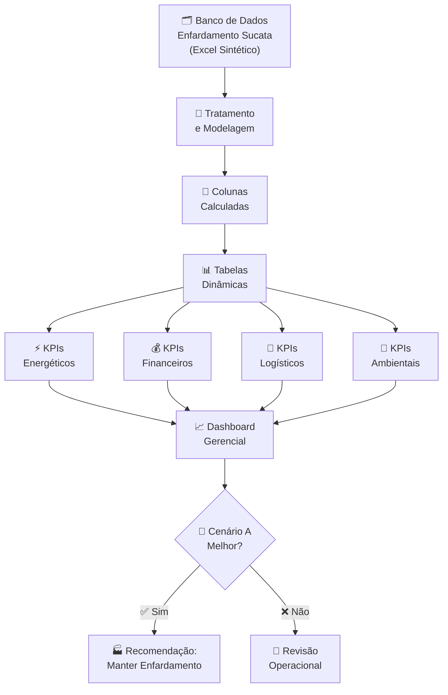
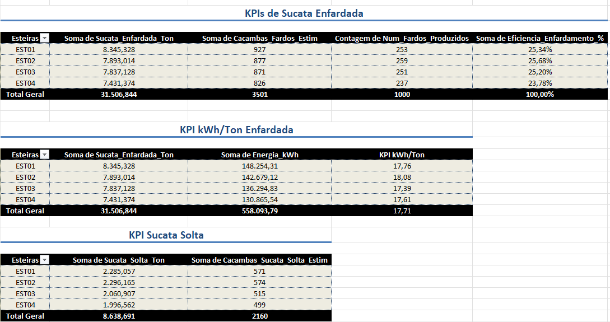
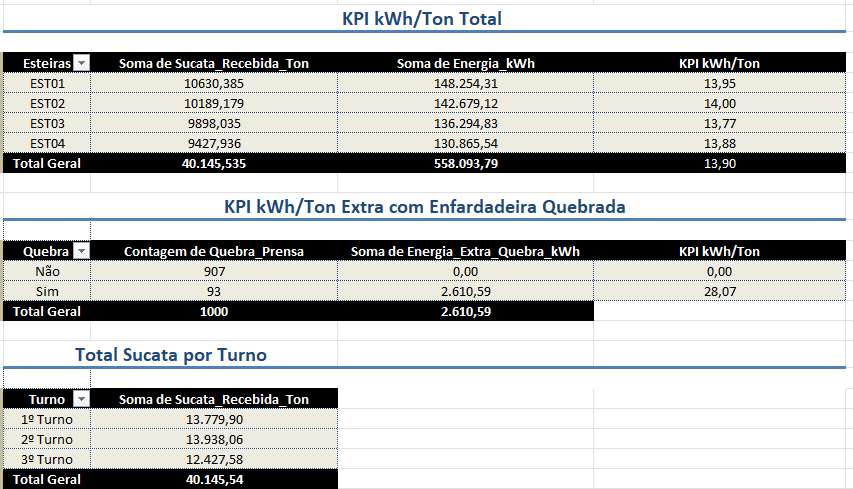
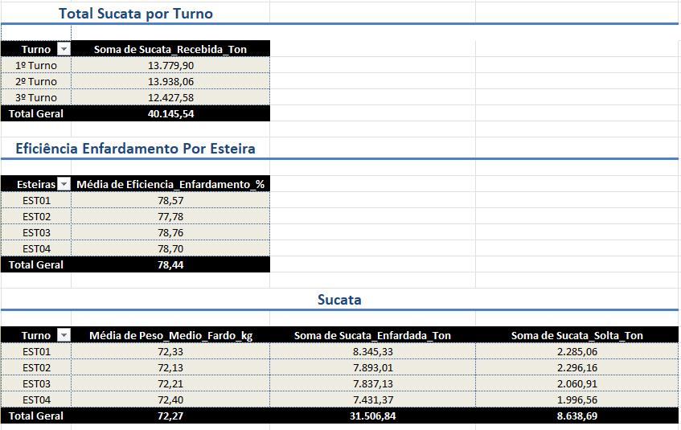
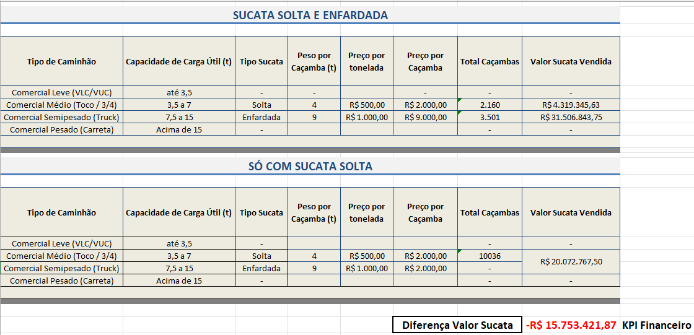
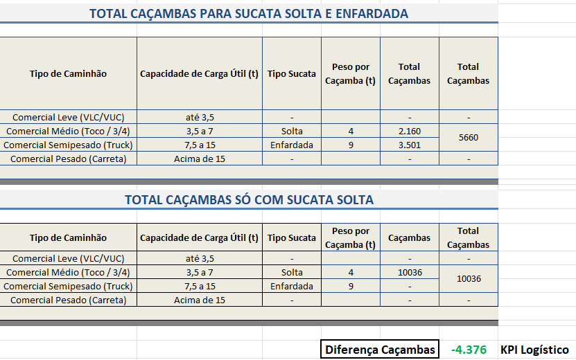
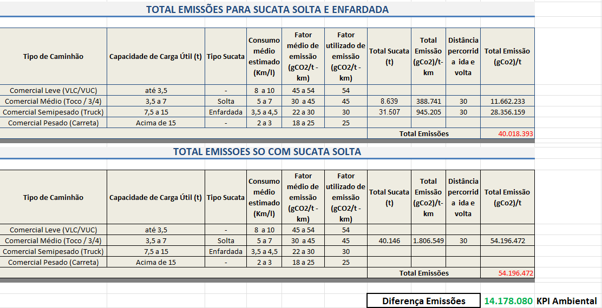
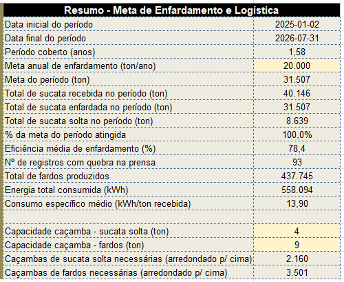

# 📊 Análise de KPIs Energéticos, Financeiros, Logísticos e Ambientais

<div align="center">


**Análise estratégica de operações industriais de enfardamento de sucata a partir de dados sintéticos**

[⚡ Energético](#-análise-energética) • [💰 Financeiro](#-análise-financeira) • [🚛 Logístico](#-análise-logística) • [🌱 Ambiental](#-análise-ambiental) • [📈 Resultados](#-principais-resultados)

</div>

---

## 📌 Sobre o Projeto

Projeto acadêmico desenvolvido com base em um **banco de dados sintético em Excel** — denominado **Banco Enfardamento Sucata** — com o objetivo de analisar indicadores operacionais, energéticos, financeiros, logísticos e ambientais relacionados ao **processo de enfardamento de sucata**.

> A proposta foi transformar dados operacionais em **informações estratégicas** por meio de Excel, Tabelas Dinâmicas, KPIs e métricas de desempenho, simulando um cenário real de **tomada de decisão industrial**.

---

## 🎯 Objetivo

Desenvolver uma solução analítica capaz de medir os impactos da operação de enfardamento de sucata sob **quatro perspectivas**:

<div align="center">

| # | 📊 Dimensão | 🎯 Foco |
|---|---|---|
| 1 | ⚡ **Eficiência Energética** | Consumo de kWh por tonelada processada |
| 2 | 💰 **Retorno Financeiro** | Redução de custos e aumento de lucratividade |
| 3 | 🚛 **Eficiência Logística** | Otimização de viagens e transporte |
| 4 | 🌱 **Impacto Ambiental** | Redução de emissões de CO₂ |

</div>

Os indicadores foram construídos para comparar **dois cenários operacionais**:

```
┌─────────────────────────────────────────────────────────────┐
│                   CENÁRIOS COMPARADOS                       │
├─────────────────────────────┬───────────────────────────────┤
│  ✅ CENÁRIO A               │  ❌ CENÁRIO B                 │
│  Sucata Solta               │  Somente                      │
│  + Sucata Enfardada         │  Sucata Solta                 │
│  (Com Enfardadeira)         │  (Sem Enfardadeira)           │
└─────────────────────────────┴───────────────────────────────┘
```

---

## 🗂️ Base de Dados

O projeto utiliza um **banco de dados sintético** desenvolvido para fins acadêmicos, contendo informações operacionais do processo de enfardamento.

### 📋 Variáveis Originais

| 🏷️ Variável | 📋 Descrição |
|---|---|
| ⚙️ `Eficiencia_Enfardamento_%` | Eficiência operacional do enfardamento |
| 📦 `Peso_Medio_Fardo_kg` | Peso médio dos fardos produzidos |
| 🏗️ `Sucata_Enfardada_Ton` | Quantidade de sucata enfardada |
| 📚 `Sucata_Solta_Ton` | Quantidade de sucata movimentada sem enfardamento |
| 📦 `Num_Fardos_Produzidos` | Total de fardos produzidos |
| ⚡ `Consumo_Especifico_kWh_Ton` | Consumo específico de energia |
| 🔋 `Energia_Base_kWh` | Consumo energético base |
| 🛠️ `Energia_Extra_Quebra_kWh` | Consumo adicional por paradas e quebras |

### 🧮 Colunas Calculadas

A partir dos dados originais foram criadas **novas métricas** para ampliar as análises:

| ⚙️ Variável Calculada | 🎯 Objetivo |
|---|---|
| ⚡ `Energia_kWh` | Energia total consumida (Base + Extra) |
| 🚛 `Cacambas_Sucata_Solta_Estim` | Estimativa de caçambas para sucata solta |
| 📦 `Cacambas_Fardos_Estim` | Estimativa de caçambas para sucata enfardada |

---

## ⚡ Análise Energética

> 📊 **Planilha:** `Tabelas Dinâmicas`

A primeira etapa do projeto consistiu na construção de **KPIs energéticos** utilizando Tabelas Dinâmicas.

### 📊 Indicadores Desenvolvidos

| ⚡ KPI | 📋 Descrição | 🎯 Finalidade |
|---|---|---|
| ⚡ **kWh/Ton Enfardada** | Consumo por tonelada enfardada | Mede eficiência do enfardamento |
| 📚 **kWh/Ton Sucata Solta** | Volume sem enfardamento | Monitora operação sem compactação |
| ⚡ **kWh/Ton Total** | Eficiência global | Visão consolidada do processo |
| 🛠️ **kWh/Ton Extra c/ Quebra** | Impacto de falhas operacionais | Avalia custo de indisponibilidade |
| 🏭 **Sucata por Turno** | Produção por turno | Comparação de desempenho entre turnos |
| ⚙️ **Eficiência por Esteira** | Produtividade por linha | Análise individual de equipamentos |
| 📦 **Soma Enfardada + Solta** | Movimentação total | Volume total de material processado |

---

## 💰 Análise Financeira

> 📊 **Planilha:** `Financeiro`

Foi elaborado um **estudo comparativo** entre os custos e os ganhos operacionais dos dois cenários analisados.

### 💰 KPI Financeiro Comparativo

```
        CENÁRIO A                        CENÁRIO B
  Enfardada + Solta                   Apenas Solta
  ┌──────────────────┐                ┌──────────────────┐
  │ 💰 Custo Logíst. │   vs.          │ 💸 Custo Logíst. │
  │ ✅ Menor         │                │ ❌ Maior         │
  ├──────────────────┤                ├──────────────────┤
  │ 📦 Fardos        │                │ 📚 Sem compactar │
  │ ✅ + Eficiente   │                │ ❌ Mais viagens  │
  └──────────────────┘                └──────────────────┘
```

### 🎯 Objetivos da Análise Financeira

- ✅ Redução de **custos logísticos e operacionais**
- ✅ Potencial **aumento de lucro** com o enfardamento
- ✅ **Ganhos de produtividade** no transporte

---

## 🚛 Análise Logística

> 📊 **Planilha:** `Caçambas`

A análise logística foi criada para **mensurar a eficiência do transporte** da sucata.

### 🚛 KPI Logístico Comparativo

<div align="center">

| 📊 Indicador | ✅ Com Enfardamento | ❌ Sem Enfardamento |
|---|:---:|:---:|
| 🚛 Nº de Viagens | **Menor** | Maior |
| 📦 Aproveitamento Volumétrico | **Maior** | Menor |
| 🚚 Necessidade de Caminhões | **Reduzida** | Elevada |
| ⏱️ Tempo de Transporte | **Otimizado** | Aumentado |
| 💰 Custo por Tonelada | **Menor** | Maior |

</div>

### 🎯 Objetivos da Análise Logística

- ✅ **Redução do número de viagens** necessárias
- ✅ **Melhor aproveitamento volumétrico** das caçambas
- ✅ **Redução da necessidade** de caminhões e equipamentos
- ✅ **Otimização** da logística de transporte

---

## 🌱 Análise Ambiental

> 📊 **Planilha:** `Emissões CO₂`

A dimensão ambiental avaliou os **benefícios sustentáveis** obtidos com o enfardamento.

### 🌱 KPI Ambiental Comparativo

<div align="center">

| 🌍 Indicador | ✅ Com Enfardamento | ❌ Sem Enfardamento |
|---|:---:|:---:|
| 🌫️ Emissões de CO₂ | **Reduzidas** | Elevadas |
| ⚡ Eficiência Energética | **Maior** | Menor |
| 🚛 Emissões por viagem | **Menores** | Maiores |
| 🌿 Gases de Efeito Estufa | **Reduzidos** | Aumentados |

</div>

### 🎯 Objetivos da Análise Ambiental

- ✅ **Redução das emissões** de CO₂
- ✅ **Melhoria da eficiência** energética
- ✅ **Redução do impacto ambiental** do transporte
- ✅ **Menor emissão** de gases de efeito estufa por tonelada movimentada

---

## 🗺️ Pipeline Analítico



---

## 🛠️ Ferramentas Utilizadas

<div align="center">

| 🛠️ Ferramenta | 📌 Uso no Projeto |
|---|---|
|  | Base principal de dados e análise |
|  | Construção de KPIs e sumarizações |
|  | Visualização dos indicadores |
|  | Cálculo das métricas e colunas derivadas |
|  | Modelagem de indicadores avançados |
|  | Suporte à interpretação dos dados |

</div>

---

## 📈 Principais Resultados

<div align="center">

| ✅ Resultado | 📋 Descrição |
|---|---|
| ⚡ **KPIs Energéticos** | Indicadores criados para avaliação operacional do consumo de energia |
| 💰 **Métricas Financeiras** | Análise de redução de custos e aumento de lucratividade |
| 🚛 **Indicadores Logísticos** | Otimização do transporte e redução de viagens |
| 🌱 **Benefícios Ambientais** | Avaliação da redução de emissões de CO₂ |
| 🤖 **Business Intelligence** | Aplicação prática de BI com dados sintéticos industriais |

</div>

---

## 🎓 Competências Desenvolvidas

- 🏭 Construção de **KPIs industriais**
- ⚡ Análise de **eficiência energética**
- 💰 **Análise financeira** aplicada à operação
- 🚛 Desenvolvimento de **indicadores logísticos**
- 🌱 Criação de **indicadores ambientais**
- 🧮 **Tratamento e modelagem** de dados
- 📊 Construção de **dashboards gerenciais**
- 📗 Desenvolvimento de **soluções analíticas em Excel**
- 🎯 **Tomada de decisão** baseada em dados

---

## 📸 Dashboard e Relatórios

> 📌 
      
      
      
      
      
      
---

## 📚 Observação

> 📖 Este projeto foi desenvolvido **exclusivamente para fins acadêmicos** utilizando dados sintéticos, com o objetivo de aplicar conceitos de análise de dados, criação de KPIs, indicadores de desempenho e visualização de informações voltadas para **operações industriais**.

---

## 🔗 Referências

- 📗 [Microsoft Excel — Tabelas Dinâmicas](https://support.microsoft.com/excel)
- 🧮 [DAX Reference — Microsoft](https://learn.microsoft.com/dax)
- 📊 [Business Intelligence — Wikipedia](https://en.wikipedia.org/wiki/Business_intelligence)
- 🌱 [GHG Protocol — Emissões CO₂](https://ghgprotocol.org)
- 🎓 [DIO — Digital Innovation One](https://www.dio.me)

---

## 👤 Autor

<div align="center">

**Desenvolvido com 💙 para fins acadêmicos — análise de dados e Business Intelligence aplicados à indústria.**

[](https://www.dio.me)
[](https://github.com)
[](https://linkedin.com)

</div>

---

<div align="center">

⭐ **Caso este projeto tenha sido útil ou interessante para você, considere deixar uma estrela no repositório!** ⭐

`📊 KPIs` • `⚡ Energia` • `💰 Financeiro` • `🚛 Logística` • `🌱 Sustentabilidade` • `📗 Excel` • `🤖 Business Intelligence`

</div>
